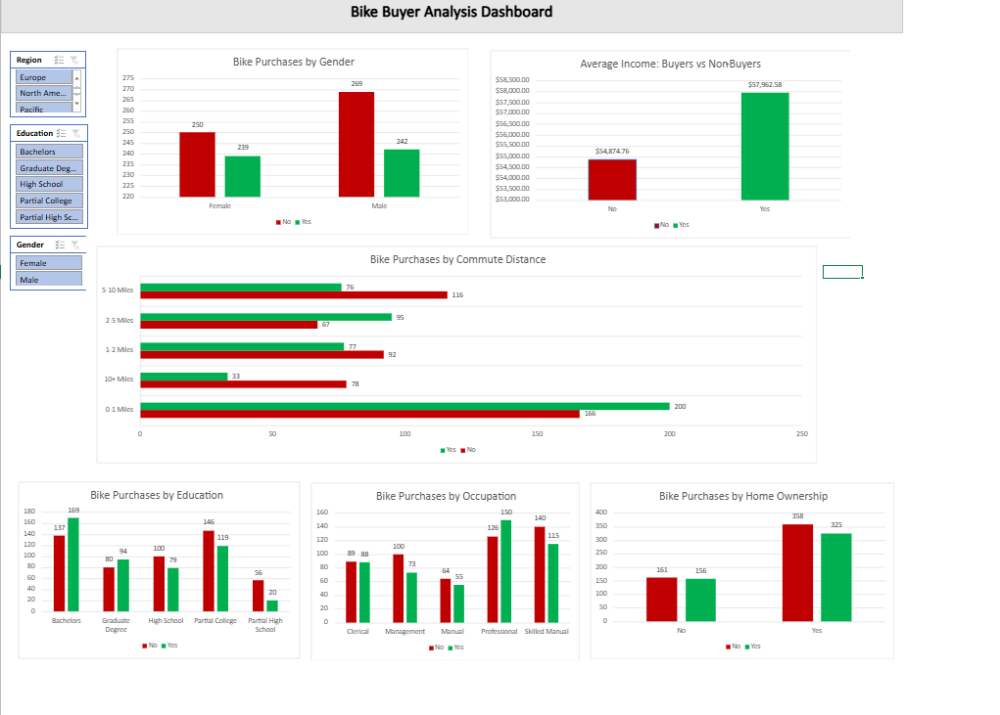
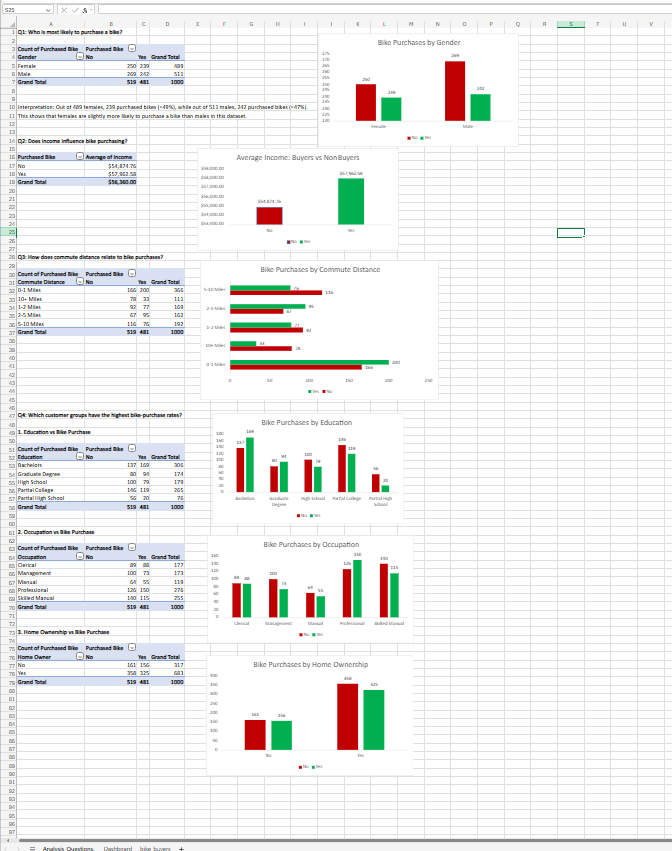

# Bike Buyers — Customer Purchase Behaviour Analysis

## Project Overview

This project explores customer purchasing behaviour using Microsoft Excel. The analysis investigates how demographic and personal characteristics relate to customers' decisions to purchase bicycles.

An interactive dashboard was developed to summarise the findings and allow users to explore customer segments through filters.

## Project Objectives

- Examine customer purchasing patterns across different demographic groups.
- Compare purchasing behaviour by gender, education, occupation and income.
- Investigate the relationship between commute distance and bicycle purchases.
- Present findings through an interactive Excel dashboard.

## Dataset

The dataset contains **1,000 customer records and 13 attributes**, covering customer demographics, income, household characteristics, commute distance and bicycle purchase decisions.

Data quality checks confirmed:
- No missing values.
- No exact duplicate records.
- No duplicate customer IDs.

## Tools and Techniques

**Tool:** Microsoft Excel

Techniques used:
- PivotTables for summarising and comparing customer data.
- PivotCharts for visualising purchasing patterns.
- Interactive slicers for filtering dashboard results.
- Customer segmentation and comparative analysis.
- Data quality checks and exploratory analysis.

## Analysis and Dashboard

The workbook includes six PivotTables and six corresponding PivotCharts, alongside an interactive dashboard.

The dashboard includes slicers for:
- Gender
- Education
- Region

These filters allow users to explore purchasing patterns across different customer groups.

### Dashboard Preview

### Supporting Analysis

## Key Findings

Some of the observations from the analysis include:

- Female customers recorded a bicycle purchase rate of approximately **48.9%**, compared with **47.4%** among male customers.
- Customers with a commute distance of 2–5 miles recorded a purchase rate of approximately **58.6%**.
- Customers who purchased bicycles had an average income of approximately **$57,963**, compared with approximately **$54,875** among non-purchasers.
- Customers with a Bachelor's degree accounted for 169 purchases out of 306 records in that education group.

These findings illustrate how customer characteristics can be explored to understand purchasing behaviour and identify potentially valuable customer segments.

## Project Files

| File | Description |
|---|---|
| `Bike_Buyers_Analysis.xlsx` | Original Excel workbook containing the dataset, analysis and dashboard. |
| `screenshots/dashboard.png` | Screenshot of the interactive dashboard. |
| `screenshots/analysis.png` | Screenshot of the supporting analysis. |

## Skills Demonstrated

- Microsoft Excel
- Data Analysis
- Data Quality Checks
- PivotTables and PivotCharts
- Interactive Dashboard Development
- Customer Segmentation
- Data Visualisation
- Analytical Interpretation

## Conclusion

This project demonstrates the use of Microsoft Excel to explore customer data, identify purchasing patterns and communicate analytical findings through an interactive dashboard.

The work highlights practical skills in data summarisation, visualisation and business-oriented analysis.
